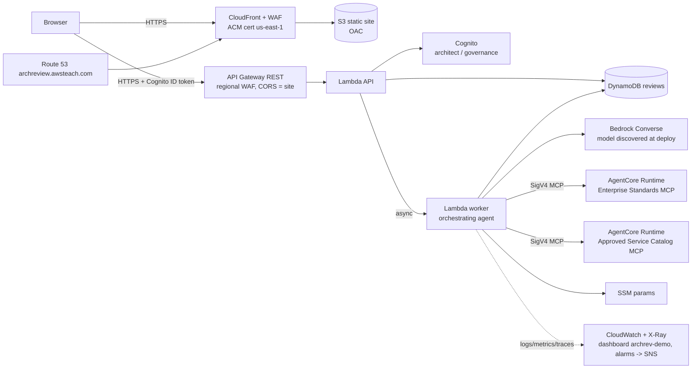

# Enterprise Solution Review Assistant (demo)

An AI agent reviews a proposed technical solution against **two independent MCP servers**: Enterprise Standards
and Approved Service Catalog. Both are hosted as separate **Amazon Bedrock AgentCore Runtime** deployments.
The agent returns a validated, cited, advisory review. **All data is synthetic** (fictional "ExampleCo").

- Live site: **https://archreview.awsteach.com** (register any user ID; password of 6+ characters; pick a user type)
- Full rebuild spec for students: [`projectknowledge.md`](projectknowledge.md) (also downloadable from the site header)
- Threat model: [`THREAT_MODEL.md`](THREAT_MODEL.md) · Deployment evidence: [`DEPLOYMENT_REPORT.md`](DEPLOYMENT_REPORT.md)

## Architecture



Region: **us-west-2**, except the ACM certificate and CloudFront WAF ACL (**us-east-1**, required by CloudFront).

### How a review works
1. `POST /reviews` validates input, enforces 10 reviews per user per hour, stores the job, and asynchronously invokes the worker.
   API Gateway's 29 s limit is why the browser polls `GET /reviews/{id}`.
2. The worker screens the input for prompt injection and derives the risk level and availability tier deterministically.
3. **Mandatory retrieval from both servers** runs in parallel: `list_required_controls`, `search_standards`, `search_services`, `find_reference_pattern`.
4. A Bedrock tool-use loop (at most 6 turns) can call all 7 MCP tools, then must call `submit_review`, which is validated against a pydantic schema.
5. A **deterministic validator** drops any standard, control, service, or pattern not actually returned by the named server.
   It adds every required control, relabels uncited "facts" as recommendations, and flags retired or restricted services.
   It builds `sources` from the real call ledger.
6. One server down gives a `partial` review. Model down gives a retrieval-only review. Every hop carries the correlation ID
   (API → worker → MCP runtimes, through the allow-listed header `X-Amzn-Bedrock-AgentCore-Runtime-Custom-Correlation-Id`).

## Repository layout
| Path | Contents |
|---|---|
| `mcp_servers/standards`, `mcp_servers/catalog` | FastMCP servers (`main.py`), pure tool logic (`tools.py`), synthetic seed data (`data/*.json`) |
| `backend/src/archrev` | `orchestrator.py` (agent), `mcp_client.py` (SigV4 MCP client), `api.py`, `worker.py`, `models.py`, `injection.py`, `risk.py`, `obs.py` |
| `frontend/` | Static site (vanilla JS, no third-party code), `examples.json` |
| `infra/` | AWS CDK (TypeScript): `EdgeStack` (us-east-1), `AppStack` (us-west-2) |
| `tests/unit`, `tests/contract`, `tests/e2e` | Unit, MCP contract (local or deployed), deployed smoke test |
| `scripts/` | `build.sh`, `deploy.sh`, `select_model.py`, `verify_mcp.py`, `local_review.py`, `teardown.sh` |
| `*.lock` | Hash-pinned Python dependency locks (`uv pip compile --generate-hashes`); `infra/package-lock.json` |

## Prerequisites
- AWS credentials with administrator access; Bedrock model access to an Anthropic or Nova model in us-west-2
- A Route 53 public hosted zone (here `awsteach.com`, `Z02882605B7GUS0L3VHX`)
- Node.js 20+ (CDK CLI comes from `npx`), Python 3.12+. **Docker is not needed**: AgentCore uses direct code deployment.

## Deploy (idempotent)
```bash
./scripts/deploy.sh                      # tests -> model discovery -> build -> bootstrap -> cdk deploy --all
ALARM_EMAIL=you@example.com ./scripts/deploy.sh   # optional alarm subscription
```
To change the hostname or zone, edit `infra/cdk.json` (`recordName`, `zoneName`, `hostedZoneId`).
The bootstrap uses qualifier `archrev` and toolkit stack `ArchRevCDKToolkit`, so it doesn't collide with other CDK apps.

## Verify
```bash
.venv/bin/python -m pytest -q                      # unit + local MCP contract tests
.venv/bin/python scripts/verify_mcp.py             # distinct runtimes + invoke every MCP tool on AgentCore
STANDARDS_RUNTIME_ARN=... CATALOG_RUNTIME_ARN=... .venv/bin/python -m pytest tests/contract -q   # contract tests vs deployed
.venv/bin/python -m pytest tests/e2e -q            # DNS/TLS/headers/CORS + full review through the live site
.venv/bin/pip-audit -r backend/requirements.lock --require-hashes --disable-pip; (cd infra && npm audit)
```
CloudWatch dashboard: **archrev-demo** (us-west-2). Search logs by `correlation_id`.

## Troubleshooting
| Symptom | Check |
|---|---|
| Review stays `queued` | Worker log group `ArchRevApp-WorkerLogs*`; Lambda throttles (reserved concurrency 10) |
| Review `partial` with "MCP server unavailable" | `/aws/bedrock-agentcore/runtimes/archrev_*-DEFAULT` logs; `aws bedrock-agentcore-control get-agent-runtime` status |
| `AccessDeniedException` from Bedrock | Re-run `scripts/select_model.py`; redeploy so `/archrev/model-ids` updates |
| Browser CORS error | Site must be opened at exactly `https://archreview.awsteach.com` |
| 403 from API | WAF rate limit (wait 5 minutes) or the `scope=all` history view used by a non-governance user |
| 429 | Per-user limit of 10 reviews per hour |
| Old site content | CloudFront invalidation runs on deploy; hard-refresh |

## Known limitations
- Each MCP tool call opens a fresh stateless session (simple, retry-friendly) and costs ~3–4 s on AgentCore, so reviews take 1–3 minutes.
- Injection screening is heuristic (defense in depth with scrubbing and output validation). No Bedrock Guardrail.
- AgentCore runtime traces are not exported (that needs account-level CloudWatch Transaction Search, which other workloads share). X-Ray covers API Gateway and Lambda; correlation IDs link the runtime logs.
- Demo-grade auth by request: 6-character passwords, no MFA, either role self-selectable.
- `npm audit`: 1 moderate (`minimatch` ReDoS bundled in `aws-cdk-lib`). Build-time only, not deployed.
- `cloudWatchRole: true` sets the account-wide API Gateway CloudWatch role in us-west-2 (none existed before deploy).

## Cost (demo scale)
Pay-per-use: Lambda, API Gateway, DynamoDB, AgentCore Runtime (active sessions only; idle timeout 5 minutes), and Bedrock
(~$0.10–0.40 per review). Fixed: 2 WAF ACLs (~$5 each + rules), dashboard (~$3), 6 alarms (~$0.60), 1 hosted zone (pre-existing).

## Teardown
```bash
./scripts/teardown.sh                    # removes both stacks, service-created log groups, and the archrev CDK bootstrap
KEEP_BOOTSTRAP=1 ./scripts/teardown.sh   # keep ArchRevCDKToolkit for faster redeploy
```
The `awsteach.com` hosted zone is not touched. The script finishes by listing any resource still tagged
`Application=EnterpriseSolutionReviewAssistant`.
